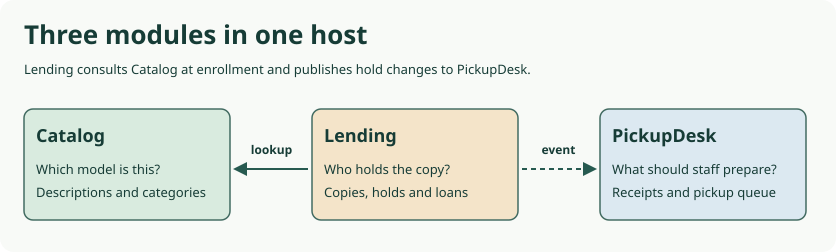

# Modular Monolith Architecture in .NET 11

A community library has one cordless drill left. Two members reserve it at the same time. Run this reference to see one member get the hold, the other receive a conflict, and a librarian prepare exactly one pickup. The API, messaging workers and staff queue run in one ASP.NET Core process. PostgreSQL gives each business module its own schema and credentials.



## Run the library

With Docker Compose and Python 3 installed, run these commands from the root of a fresh clone.

```sh
docker compose up -d --build --wait
python3 tests/Journeys/borrow_a_drill.py
```

The walkthrough creates a catalog item and a uniquely barcoded copy, sends **two concurrent HTTP reservation requests**, then exercises staff preparation, collection, renewal, return and cancellation. It prints the winning hold ID. Run it again to create another copy. The API listens on http://127.0.0.1:5284. Open `/openapi/v1.json` to inspect its routes. If that port is occupied, set `LIBRARY_HTTP_PORT` when starting Compose and pass the corresponding `--base` to the walkthrough. Run `docker compose down` to stop the stack and keep its data.

## Explore the use cases

| Module | What you can do | Code and API guide |
| --- | --- | --- |
| Catalog | Publish and edit equipment descriptions, search the catalog, archive and restore items, create categories, classify equipment and browse a category. | [Catalog guide](docs/modules/catalog.md) · [Use cases](src/Modules/Catalog/Implementation/) |
| Lending | Enroll physical copies, check availability, reserve the last copy, cancel or collect a hold, list a member's holds and loans, renew or return a loan, retire or reinstate a copy, and inspect circulation history or overdue equipment. | [Lending guide](docs/modules/lending.md) · [Use cases](src/Modules/Lending/EquipmentLibrary.Lending/) |
| PickupDesk | Browse and filter the queue, claim or release preparation, report and resolve an issue, mark a pickup ready, review staff workload, inspect closed pickups and recover a quarantined event. | [PickupDesk guide](docs/modules/pickupdesk.md) · [Use cases](src/Modules/PickupDesk/PickupDesk/Features/) |

```sh
# Public catalog
curl --fail http://127.0.0.1:5284/api/catalog/items

# Librarian's work queue in the local demo
curl --fail -H 'Authorization: Bearer demo-staff' http://127.0.0.1:5284/api/pickup-desk/queue
```

The development profile supplies two member identities (`demo-borrower-a` and `demo-borrower-b`), general staff (`demo-staff`), and pickup staff (`demo-pickup`). Production uses JWT bearer authentication with a configured HTTPS authority and audience. The compose recipe binds both host ports to loopback and uses development-only credentials.

## Follow a reservation through the source

1. The [host](src/Api/Program.cs) composes the modules. Lending uses the [public Catalog lookup](src/Modules/Catalog/Contracts/) when enrolling a copy.
2. [PlaceHold](src/Modules/Lending/EquipmentLibrary.Lending/Holds/PlaceHold.cs) conditionally acquires the copy and commits the hold and its outgoing event together.
3. The [outbox relay](src/Modules/Lending/Delivery/) delivers the original message to the [PickupDesk inbox](src/Modules/PickupDesk/PickupDesk/Inbox/). The consumer records its result and receipt in one transaction. A later terminal state wins over a delayed placement.
4. The [HTTP journey](tests/Journeys/borrow_a_drill.py) checks the losing response, private borrower access, the staff queue and the copy's return to circulation.

Read the [delivery and recovery guide](docs/operations/messaging.md) for a real crash experiment, queue diagnostics and audited redrive. Follow the [illustrated walkthrough](docs/tour/trace-a-hold.md) for the complete path.

## Develop and test

Install the SDK in [global.json](global.json). For an SDK inner loop, start the database and migrations with `docker compose up --build -d postgres migrate`, then run `dotnet run --project src/Api --launch-profile EquipmentLibrary`. Use the containerized API or the SDK host on port 5284 one at a time. The liveness endpoint is `/health`. The readiness endpoint `/ready` checks that the three module roles can reach their migrated tables.

```sh
./scripts/verify.sh
./scripts/check-analyzers.sh
./scripts/verify.sh tests/Modules/Lending/EquipmentLibrary.Lending.Tests.csproj
```

Module tests use disposable PostgreSQL databases. The [architecture checks](tests/Architecture/) enforce project and compiled dependencies. [AGENTS.md](AGENTS.md) maps a feature to its owner, public contract and verification commands. The [charter](docs/charter.md) and [contributing guide](CONTRIBUTING.md) explain the project scope.

Milan Jovanović's Evently course informed the coding conventions. Kamil Grzybek's work influenced the use of domain language, diagrams, decision records and architecture tests. [Modular Monolith Architecture course](https://milanjovanovic.tech/modular-monolith-architecture) · [Modular Monolith with DDD](https://github.com/kgrzybek/modular-monolith-with-ddd)
