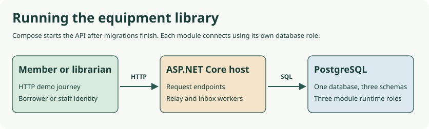

# Learn the architecture through one copy

Start the [runnable equipment library](../README.md#run-the-library), then follow the drill from its catalog description to the staff pickup queue. For a measured example, a fresh GitHub-hosted `ubuntu-latest` job spent 31 seconds in `docker compose up -d --build --wait --wait-timeout 120` and 2 seconds running the borrower and staff journey. The measurement includes building the images, starting PostgreSQL, applying migrations and waiting for readiness. Docker image download speeds and runner caches affect elapsed time. [Recorded CI run at c48a0cd](https://github.com/m-jovanovic/modular-monolith/actions/runs/45394905659)

| Question | Follow the evidence |
| --- | --- |
| Why can two members race for a copy while only one succeeds? | [Reservation trace](tour/trace-a-hold.md), [atomicity decision](decisions/atomic-reservation.md), [concurrent API test](../tests/Modules/Lending/ReservationTests.cs) |
| Who owns availability? | [Domain vocabulary](glossary.md), [ownership decision](decisions/owned-data.md), [database grants](architecture/database-ownership.md) |
| Why does a successful reservation sometimes take a moment to reach the queue? | [Delivery timeline](tour/trace-a-hold.md), [receipt decision](decisions/durable-delivery.md), [restart exercise](../tests/Journeys/recover_delivery.py) |
| How can a reviewer catch an illegal module reference? | [Dependency rules](architecture/dependency-rules.md), [mixed-dependency regression fixture](../tests/Architecture/BoundaryRegressionTests.cs) |
| Can an agent make a scoped change without crossing a module boundary? | [Grading decision](decisions/agent-evaluation.md), [frozen tasks and measured attempts](../tests/AI/README.md) |
| How can I reuse the diagrams and source snippets? | [Release format and verification](maintainers/reference-releases.md), [editable drawing sources](diagrams/design) |

## Deployment

A short-lived migration container provisions the database before API startup. The application host contains the HTTP endpoints, Lending's relay and PickupDesk's inbox worker. Module-owned roles restrict what each data source can see even though PostgreSQL runs as a single service. [Compose configuration](../compose.yaml)

## Contribute or get help

For development setup and verification, see the [contributor guide](../CONTRIBUTING.md). Use the [public issue tracker](https://github.com/m-jovanovic/modular-monolith/issues) for reproducible bugs and architecture questions. Include the Git tag, command, expected behavior and observed result. Remove private credentials and borrower information. Milan Jovanović maintains the public examples and approves changes to published seams. Explore the companion material at [modularmonolith.com](https://modularmonolith.com).
