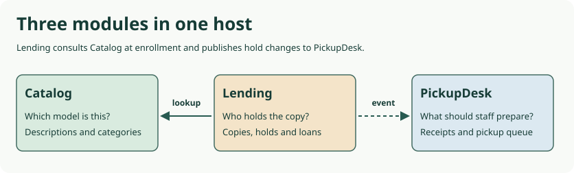
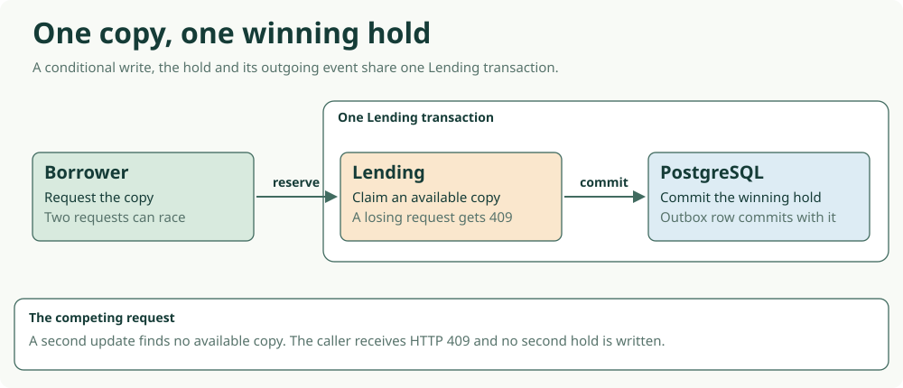
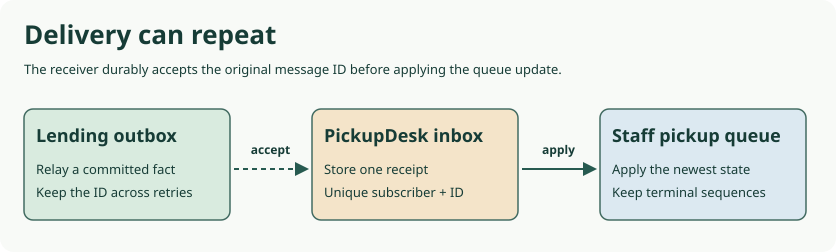

# Trace a hold



A librarian publishes the description of a cordless drill and enrolls a physical copy against that model. The [enrollment slice](../../src/Modules/Lending/EquipmentLibrary.Lending/Copies/EnrollCopy.cs) calls Catalog once and writes the barcode to Lending. Catalog can have one description shared by many copies.



Two signed-in borrowers try to reserve that barcode. Follow the [conditional write](../../src/Modules/Lending/EquipmentLibrary.Lending/Holds/PlaceHold.cs), then the [outbox insert](../../src/Modules/Lending/EquipmentLibrary.Lending/Holds/HoldEvents.cs). The transaction gives precisely one request a hold. Run the proof against PostgreSQL:

```sh
dotnet test tests/Modules/Lending/EquipmentLibrary.Lending.Tests.csproj --filter FullyQualifiedName~LastCopyHasOneWinnerAndOneOutboxEvent
```



The worker can deliver the same fact again after a restart. Inspect the [durable receipt](../../src/Modules/PickupDesk/PickupDesk/Inbox/PickupInbox.cs) and [projection upsert](../../src/Modules/PickupDesk/PickupDesk/Inbox/ApplyHoldSnapshot.cs). The receiver can acknowledge an already-persisted message, and a terminal snapshot continues to win over an older placement.

```sh
dotnet test tests/Modules/PickupDesk/EquipmentLibrary.PickupDesk.Tests.csproj --filter FullyQualifiedName~RepeatedDeliveryAndConcurrentWorkersProduceOnePendingPickup
dotnet test tests/Modules/PickupDesk/EquipmentLibrary.PickupDesk.Tests.csproj --filter FullyQualifiedName~TerminalSnapshotRemainsClosedWhenPlacementArrivesLate
```

Continue with the [glossary](../glossary.md), [data ownership](../decisions/owned-data.md), [reservation decision](../decisions/atomic-reservation.md) and [delivery decision](../decisions/durable-delivery.md).
